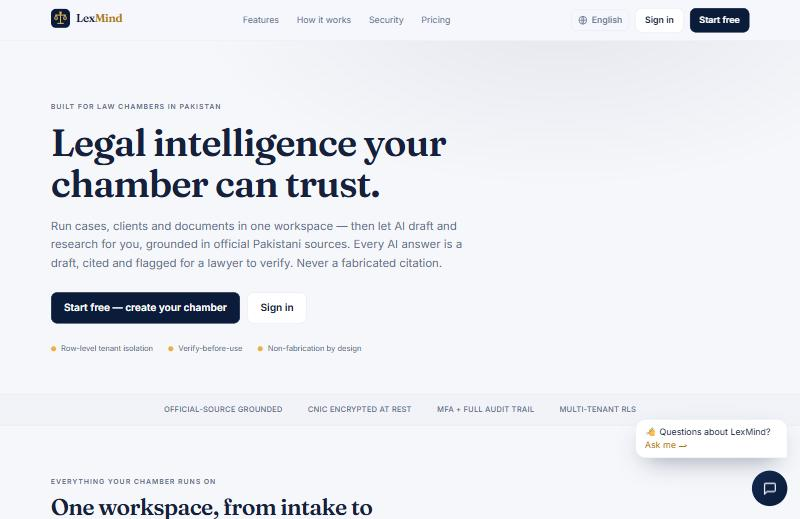
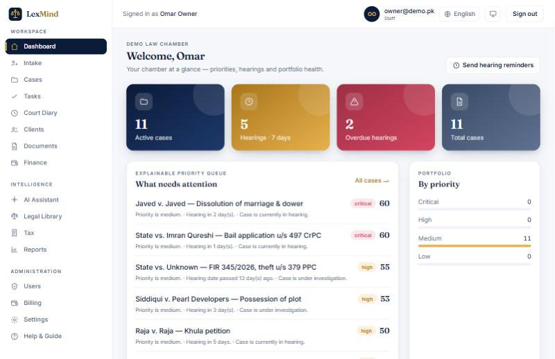
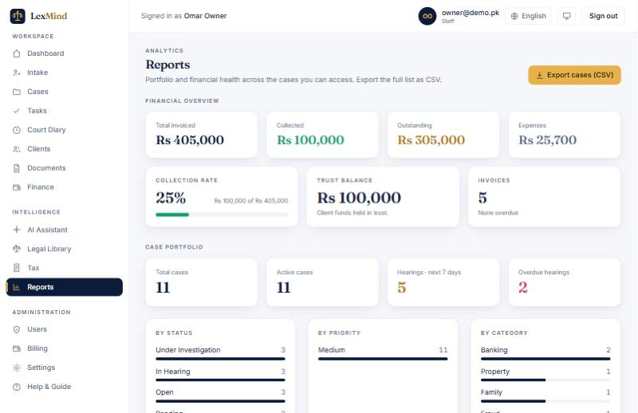
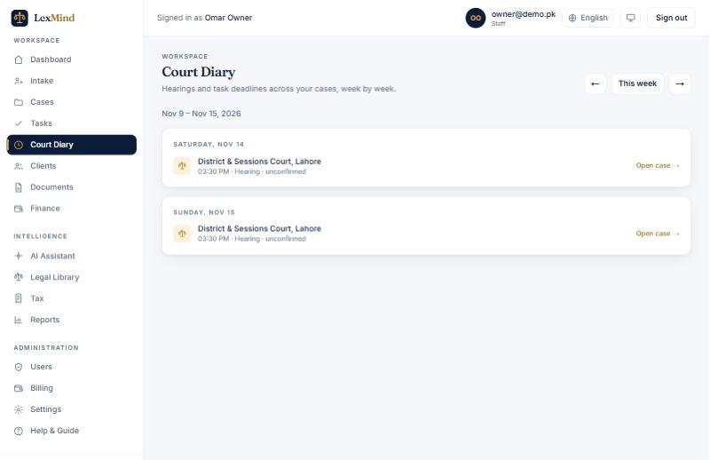
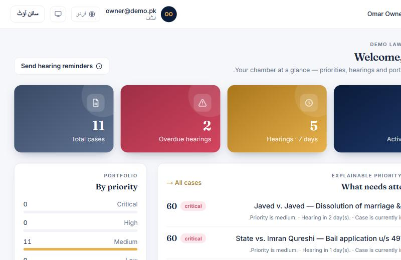

# ⚖️ LexMind AI

**AI legal & tax intelligence + practice-management SaaS, built Pakistan-first.**

A production-oriented, secure, **multi-tenant** platform that helps law chambers run cases, clients, documents, hearings, tax and billing in one workspace — with an AI assistant that researches and drafts, **grounded in official sources and always flagged for a lawyer to verify**.

    -a9761a)

> **Design principle:** The AI assists qualified lawyers; it never replaces their judgment. Every legal conclusion is traceable to a source and reviewed by a lawyer before it is final — *non-fabrication by design.*

---

## 🔗 Live demo

| | |
|---|---|
| **Web app** | https://lexmind-ai-iota.vercel.app |
| **API docs** | https://lexmind-api-production-6af40992.up.railway.app/docs |

**Try it (demo chamber, pre-populated):**
- Chamber ID: `demo-chamber`
- Email: `owner@demo.pk`
- Password: `DemoPass123!`

> Switch language (English / اردو / العربية) from the header — the dashboard flips to RTL for Urdu/Arabic.

---

## 📸 Screenshots

| Landing | Dashboard |
|---|---|
|  |  |

| Financial reports | Court diary |
|---|---|
|  |  |

**Multilingual — dashboard in Urdu (right-to-left):**



---

## ✨ Features

**Practice management**
- Cases (status, priority, timeline, notes), clients (encrypted CNIC + conflict-of-interest screening), intake/lead screening
- Documents with **version history** + text extraction/indexing
- **Court diary** (calendar of hearings + task deadlines), tasks & workflow, in-app notifications

**AI & legal intelligence**
- AI assistant using **RAG with source citations** and non-fabrication safeguards (verify-before-use)
- AI drafting, case analysis, legal library + Pakistan tax reference
- **Voice input** (speech-to-text) on the assistant

**Finance**
- Invoices, payments, expenses, **client trust accounting**, recurring billing (retainers), financial reports

**Client portal**
- A client sees **only their own** cases, invoices and documents — scoped by `client_id` on top of org-level isolation

**Security & accounts**
- **Multi-tenant isolation via PostgreSQL Row-Level Security (RLS)**
- RBAC across 13 roles; Argon2id passwords; **TOTP MFA**; device/session management; **email-OTP-verified signup**; password reset & Chamber-ID recovery

**SaaS & platform**
- Subscription plans with server-side enforcement (**trial → grace → read-only**, data never deleted)
- Full **i18n (English / Urdu / Arabic with RTL)**, light/dark theme, mobile-responsive, SEO/OpenGraph

---

## 🧱 Tech stack

- **Frontend:** Next.js (App Router) · React · TypeScript · Tailwind CSS
- **Backend:** Python 3.12 · FastAPI · Pydantic · SQLAlchemy · Alembic — deps via **`uv`** (not pip)
- **Data:** PostgreSQL + pgvector · Redis · S3-compatible object storage
- **AI:** provider-agnostic LLM gateway · RAG over pgvector · citation verification
- **Infra:** Docker · Celery workers · CI · deployed on **Vercel** (web) + **Railway** (API/DB/Redis/worker); migrations auto-applied on deploy

## 🔒 Engineering principles

- Backend-enforced RBAC + tenant isolation — **never trust the frontend**
- No fabricated legal citations, sections, dates or URLs — verified or marked unverified
- Retrieved content is untrusted **data, never instructions** (prompt-injection defense)
- Secrets only via environment / secrets manager
- No feature is "done" until implemented **and** tested

## 📄 Docs

- [Competitive benchmark & gap roadmap](docs/COMPETITIVE_BENCHMARK.md)
- [Production-readiness report](docs/PRODUCTION_READINESS.md)
- [Architecture](docs/architecture/01-system-architecture.md) (system, RBAC, DB ER, security, AI agent, …)

## 🚀 Getting started

Prerequisites: Docker + Docker Compose; and for local work, `uv` and Node 22+.

```bash
cp .env.example .env
cp backend/.env.example backend/.env
cp frontend/.env.example frontend/.env
docker compose up --build
```

- API: http://localhost:8000 (docs at `/docs`) · Web: http://localhost:3000 · MinIO: http://localhost:9001 · Mail (Mailpit): http://localhost:8025

**Backend only:**
```bash
cd backend && uv sync && uv run uvicorn app.main:app --reload
uv run pytest && uv run ruff check .
```

**Frontend only:**
```bash
cd frontend && npm install && npm run dev
```

> Backend dependencies use **`uv`** — do not use plain `pip`.

## 📌 Honest status

Core legal + tax + finance + AI workflows, security (MFA, RLS, sessions), subscription enforcement and the client portal are implemented and verified end-to-end. Items that require external accounts (not code) before a full commercial launch: a **payment gateway**, **Google OAuth** credentials, and **Resend email-domain verification** (so transactional emails reach every address). Deliberately deferred for a dedicated effort: cross-tenant super-admin and full per-page Urdu/Arabic translation. See the [production-readiness report](docs/PRODUCTION_READINESS.md).

## License

MIT
