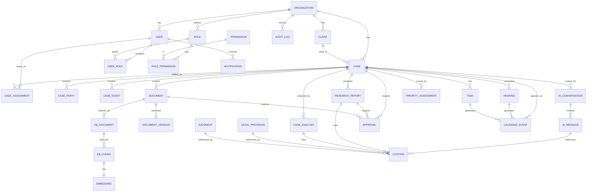

# 05 — Database Design & ER Diagram

## Conventions

- **Primary keys:** UUID (v4) for all tenant-facing entities (non-guessable, safe in URLs/APIs, merge-friendly).
- **Every tenant-owned table has:** `id`, `organization_id` (FK, indexed, part of RLS policy), `created_at`, `updated_at`, `created_by`, and `deleted_at` (nullable — soft delete where appropriate).
- **Foreign keys** enforced in-DB; **indexes** on all FKs and common filter columns (`organization_id`, `status`, `next_hearing_date`, `assigned_lawyer_id`).
- **Enums** modeled as lookup tables or Postgres enums where the set is stable (e.g. `case_status`); free-form + lookup for extensible sets (case categories allow custom).
- **Embeddings** stored in `pgvector` column(s) with an IVFFlat/HNSW index.
- Timestamps in UTC; display localized (Asia/Karachi) in the UI.

## Entity-relationship diagram (Mermaid)

## Key tables (selected columns)

### organization
`id, name, slug, plan, status, settings_json, data_retention_policy, created_at, updated_at`

### user
`id, organization_id, email(unique per org), password_hash(argon2id), full_name, phone, status, mfa_enabled, mfa_secret_enc, last_login_at, created_at, updated_at, deleted_at`
> Clients are users with a client-type principal; portal access flagged and heavily scoped.

### role / permission / role_permission / user_role
- `role(id, organization_id, name, is_system)`
- `permission(id, code, description)` — global catalog
- `role_permission(role_id, permission_id, scope)` — scope ∈ {all,assigned,own,self}
- `user_role(user_id, role_id)`

### client
`id, organization_id, full_name, cnic_enc, contact_json, address, assigned_lawyer_id, created_by, created_at, ...`
> CNIC and other government IDs stored **encrypted at rest**; access audited.

### case
`id, organization_id, title, case_number, category, custom_category, client_id, opposite_party, court_name, judge_name, police_station, fir_number, district, province, status, priority, priority_overridden_by, filing_date, next_hearing_date, description, legal_issues_json, assigned_lawyer_id, created_by, created_at, updated_at, deleted_at`

### case_assignment
`id, case_id, user_id, role_on_case (primary|supporting), assigned_by, assigned_at`

### case_party
`id, case_id, name, party_type (client|opposite|witness|other), details_json`

### case_event (append-only timeline)
`id, case_id, event_type, actor_id, payload_json, occurred_at` — **immutable** (no update/delete).

### hearing
`id, case_id, court_name, scheduled_at, status (unconfirmed|confirmed|held|adjourned), confirmation_source, notes, created_by`

### document / document_version
- `document(id, organization_id, case_id, title, category, storage_key, mime, size, checksum, scan_status, current_version, access_level, created_by, ...)`
- `document_version(id, document_id, version_no, storage_key, checksum, created_by, created_at)`

### knowledge base & vectors
- `kb_document(id, organization_id, source_type, source_ref, access_metadata_json, status)`
- `kb_chunk(id, kb_document_id, organization_id, chunk_index, text, tsv tsvector, access_metadata_json)`
- `embedding(id, kb_chunk_id, organization_id, vector vector(N), model, created_at)` — HNSW/IVFFlat index; queries always filter `organization_id` + access metadata **before** ANN ranking.

### legal_provision / judgment (verified reference cache)
- `legal_provision(id, law_name, section, text, source_url, retrieved_at, verification_status, amended_flag)`
- `judgment(id, title, citation, court, judgment_date, source_url, retrieved_at, verification_status, treatment_note)`
> These are a **verification cache**, not a source of truth; every row carries `verification_status` and `source_url`.

### citation (traceability — the anti-hallucination spine)
`id, organization_id, cited_from_type (ai_message|research_report|case_analysis), cited_from_id, provision_id?, judgment_id?, quoted_text, para_or_page, source_url, verification_status (verified|pending|unverified|conflicting), verified_at, verifier(auto|user)`

### ai_conversation / ai_message
- `ai_conversation(id, organization_id, user_id, mode (general|case), case_id?, title, created_at)`
- `ai_message(id, conversation_id, role, content, workflow_run_id?, feedback, created_at)`

### research_report / case_analysis / priority_assessment
- `case_analysis(id, case_id, organization_id, report_json (18 sections), status (draft|approved), generated_by (workflow_run_id), approved_by, created_at)`
- `priority_assessment(id, case_id, score, level, factors_json (explainable), computed_at, overridden, override_reason, override_by)`

### approval
`id, organization_id, target_type, target_id, requested_by, approver_id, status (pending|approved|rejected), decided_at, comment`

### task / notification / calendar_event / audit_log
- `task(id, organization_id, case_id?, title, assignee_id, due_at, status, created_by)`
- `notification(id, organization_id, user_id, channel, type, payload_json, read_at, sent_at)`
- `calendar_event(id, organization_id, source_type, source_id, starts_at, ends_at, title)`
- `audit_log(id, organization_id, actor_id, action, resource_type, resource_id, result (allow|deny), ip, user_agent, metadata_json, created_at)` — append-only.

## Isolation & integrity notes
- RLS policy on every tenant table: `organization_id = current_setting('app.current_org')::uuid`.
- `case_event` and `audit_log` are append-only (enforced by DB rule/trigger + no update/delete permission).
- Soft delete (`deleted_at`) for cases/clients/documents to preserve legal record integrity; hard delete only via explicit, audited retention-policy jobs.
